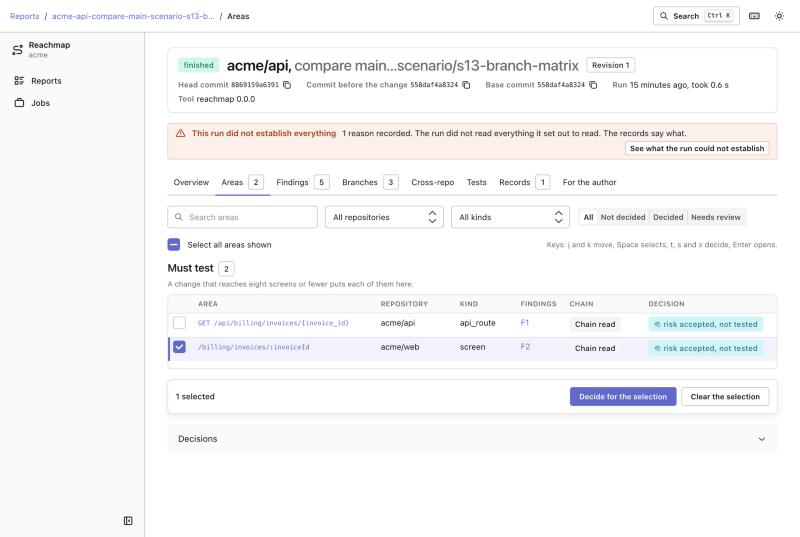

# Quickstart

This page takes one change from a repository to a report, then to recorded decisions and a
rerun. Every command and every piece of output below was run on the example workspace in
`examples/` (four invented repositories of a company called "acme"). Paths in output are
shortened, and the version in the first line of a summary is the one that was installed.

To get the same output yourself, in a checkout of this repository:

```text
python3 tests/fixtures/build.py /tmp/acme-fixtures
export REACHMAP_FIXTURES=/tmp/acme-fixtures
python3 -m reachmap analyse --config examples/reachmap.toml --repo acme/web --compare main...scenario/s01-shared-component
```

The commands below leave out `--config examples/reachmap.toml` and the `python3 -m` prefix,
because a `reachmap.toml` of your own is the default. `python3 examples/run_example.py` runs
all the steps of this page in order.

Contents: [install](#install), [configure](#configure), [analyse a change](#analyse-a-change),
[read the report](#read-the-report), [the workspace](#the-workspace-reachmap-serve),
[decisions](#decisions), [rerun and staleness](#rerun-and-staleness),
[a model client](#a-model-client-reachmap-mcp), [where things are kept](#where-things-are-kept),
[exit codes](#exit-codes).

## Install

You need Python 3.11 or newer and `git`. Reachmap has no dependencies and no npm step: the
workspace that `reachmap serve` shows is built into the package.

Release 0.1.0 is early. There are three ways to use it:

- **From PyPI**, if the package is published there: `pip install reachmap`, then `reachmap --version`.
- **From a wheel file**: `pip install <the file>.whl`, then `reachmap --version`.
- **From a checkout, without installing**: run `python3 -m reachmap` from the repository root in
  place of `reachmap`. The workspace of `reachmap serve` needs the frontend build, and without it
  you get the minimal page (see [the workspace](#the-workspace-reachmap-serve)).

Reachmap reads code with your own access. For a repository on a host it uses the host's own
login or a token from an environment variable, and it stores nothing:

| Host | How it signs in |
|---|---|
| GitHub | `gh auth login` (the `gh` command makes the requests) |
| GitLab | `glab auth login`, or a token in `GITLAB_TOKEN` |
| Bitbucket Cloud | a token, or `user:app_password`, in `BITBUCKET_TOKEN` |
| plain git | nothing: any repository `git` can clone, local or remote |

The plain git host has no pull requests, so it works with a comparison or a range, which is
enough to try everything on a repository of your own.

## Configure

A workspace is a file, `reachmap.toml`, that lists your repositories. For one local
repository, with the file saved in the repository's own folder, it is this:

```toml
workspace = "acme"

[repos."acme/web"]
host = "git"
remote = "."                  # a path, resolved against the folder of this file
language = "typescript"
roles = ["frontend"]
branches = ["main", "release/*"]
entry_points = { kind = "react-router", routes_glob = "src/modules/*/routes.tsx" }
```

Set `routes_glob` to the files of your own that hold the `<Route>` elements. Without it the
default is `src/**/routes.tsx`, `src/**/routes.jsx`, `src/**/routes.ts` and `src/**/routes.js`.
A glob that matches no file is a blocking `routes_unmatched` record and an answer that says it
is not complete, so a typo does not read as "no screens". A mistyped key in this table is
refused when the file loads, with the nearest allowed name (see [docs/config.md](config.md)).

A few things that surprise a first run:

- Only committed work is read: a branch you have not committed to, and uncommitted changes, are
  not seen. `--compare` takes names the remote has.
- `branches` defaults to `["main"]`. A repository whose main branch is `master` should say
  `branches = ["master", "release/*"]`, or the branch matrix has nothing to read.
- The reports go to a `reports/` folder in the folder you run the command from; add it to your
  `.gitignore`.

### Let `reachmap init` write it

Instead of writing the file, give `reachmap init` the repositories. It reads each one with git (at its default
branch), and prints a starter file; `NAME=SPEC` chooses the name a repository has in the file:

```text
$ reachmap init acme/web=. > reachmap.toml
reachmap: wrote the config for 1 repository: 12 guesses to confirm (each has a `# guess:` comment above it); review the file before running reachmap analyse
$ grep -A1 'guess: tsconfig' reachmap.toml
# guess: tsconfig.json declares 3 path target(s), every one of which exists in the tree, evidence tsconfig.json:9, confidence high; confirm
# guess: jsconfig.json is not used: 3 of its 3 path targets do not exist in the tree, evidence jsconfig.json:4, confidence medium; confirm
```

Confirm the guesses. Every detected role, language, branch pattern, alias file, route file, endpoints file, contract and
edge has a comment above it with the reason, the evidence and a confidence word (`high`, `medium`, `low`); a low one
deserves a look first. A comment that is not a guess says what was left out and why, for example a YAML OpenAPI spec
(it is not read: convert it to JSON), a module of URL constants that nothing calls, or an HTTP edge that two servers
could both answer. Two values are never guessed: `distinct_max` (a name defined more often than this is not used to
link code) stays at its default, and a test source token is only ever named, in a comment, by the environment variable that holds it.

A repository that cannot be read (no access, an empty repository, no supported language) is listed in a "Could not
read" block of the file and so is every file that could not be read (a symlink, a name that is not UTF-8, a file
nested too deeply to parse); the exit code is 3 for either, and the file is still written for the rest. `--out FILE`
writes a file atomically instead of printing, and `--force` replaces one that exists.

`entry_points` says what a person can test in this repository: here, screens from React Router
routes. Without it a change reaches no screen. For several repositories, add one
`[repos."..."]` table each and one `[[edges]]` table for each link between them: a frontend
that calls a backend (`http`), a package a repository pins (`package`), a shared data model
(`contract`). `examples/reachmap.toml` is a complete file for four repositories, and
[docs/config.md](config.md) describes every key.

A mistake in the file is reported once, whole, with the key of each problem and never the
value you wrote. (A value you type on the command line, such as a repository name, is echoed in
its error, because you just typed it; a value from the config file never is.)

```text
reachmap: error: config error: bad.toml: 2 problems in the config
  repos."a/b".bogus: unknown key; allowed keys: host, remote, language, roles, branches, aliases, entry_points, http_client, tests, service_marker, contract, primary_branch, library_roots, http_server
  repos."a/b".language: unknown language; allowed: javascript, python, typescript
```

## Analyse a change

`reachmap analyse` takes a repository as the config names it and one change. The change is a
pull request, a comparison or a range:

```text
reachmap analyse --repo acme/api --pr 812
reachmap analyse --repo acme/web --compare release/3...main
reachmap analyse --repo acme/contracts --range v1.9.0..v1.10.0
```

- **`--pr N`** (also `#N`, and `!N` for a GitLab merge request) reads the title, state, base
  and head from the host. It needs a hosted repository (`host` is `github`, `gitlab` or
  `bitbucket`). On a plain git repository it says so and writes a failed report:

  ```text
  reachmap: the change could not be analysed: host git has no change requests: use a compare (base...head) or a range (a..b)
  Report: reports/acme-web-pr-12-56778b7b-unresolved-failed-268fbe98.json
  ```

- **`--compare BASE...HEAD`** (three dots) is what HEAD has since its merge base with BASE:
  the usual shape of a topic branch against the main branch. Two dots are refused.
- **`--range A..B`** (two dots) is everything from A to B, for two tags or two commits.

Run from the folder that holds `reachmap.toml`, with the files in `examples/` this prints:

```text
$ reachmap analyse --repo acme/web --compare main...scenario/s01-shared-component
reachmap 0.1.0: acme/web, compare main...scenario/s01-shared-component, head 7fbf97d99854
Areas to test: 4 (must test 4)
  must test  screen /billing/invoices (acme/web)
  must test  screen /billing/invoices/:invoiceId (acme/web)
  must test  screen /cases (acme/web)
  must test  screen /cases/:caseId (acme/web)
Findings: 4 (direct 4)
Branches: main pre_change, release/2.0 pre_change, release/2.1 pre_change
Report: reports/acme-web-compare-main-scenario-s01-shared-component-941269bf-7fbf97d99854-r1.json
```

The first line names the version you installed and the commit analysed. The change is one
edit of a shared component, and four screens import it. A report is a JSON
file in `reports/` (change `--out` for another folder). The JSON is always written, and the
other formats are rendered from it:

| Option | What it does |
|---|---|
| `--format json,md,html` | Also write Markdown and a single self-contained HTML file beside the JSON, with the same base name. |
| `--out DIR` | Where reports go. Default: `reports`. |
| `--config FILE` | The workspace file. Default: `reachmap.toml`. |
| `--as-of ISO` | Pin the branches, tags and heads read by name to this time (for example `2025-03-01T12:00:00Z`; a time with no zone is UTC). A commit named by hash is a pin already. It does not move a pull request's own commits, the hosted test sources or the tags of a producer package (they are listed as they are now), and the report says so. |
| `--decisions FILE` | Import the decisions the HTML report exported. See [decisions](#decisions). |
| `--quiet` | Print nothing for a run that completes with nothing blocking. |

A report can also be rendered later, to a file or standard output:

```text
reachmap report reports/acme-web-compare-main-scenario-s01-shared-component-941269bf-7fbf97d99854-r1.json --format html --out report.html
reachmap report reports/<name>.json                       # Markdown to standard output
reachmap report reports/<name>.json --view author         # the header and the author section
```

The HTML file has no network use and no links, and can be attached to a pull request or a
ticket. Open it in any browser.

### A change that crosses repositories

When a change reaches code in another repository through a link you configured, the summary
names areas in every repository it reached. A field of a shared data model became required, and a
backend route and a frontend screen both depend on it:

```text
$ reachmap analyse --repo acme/contracts --compare main...scenario/s11-contract-field
reachmap 0.1.0: acme/contracts, compare main...scenario/s11-contract-field, head 4c34307950bd
Areas to test: 2 (must test 2)
  must test  api_route GET /api/billing/settlements/summary (acme/api)
  must test  screen /billing/settlements (acme/web)
Findings: 8 (contract-tightened 2, cross-repo 2, exclusion 2, release 2)
Branches: main pre_change
Also not established, without blocking: 2 record(s) in the report
The lists above may be incomplete: the report says what was not established.
```

The last two lines say that the report holds records of what the run did not establish. Read
the section "What the run could not establish" before you rely on the list.

## Read the report

A report has the same sections, in the same order, in Markdown, in HTML and in the workspace.
Here is what each one is for, with the Markdown of the first example above.

**Header and counts.** Which change, which commit, and a count of areas, findings and records.
A whole run says nothing about being complete. Only a run that did not establish everything says
so, and it says so at the top.

**Areas to test.** The screens and entry points the change reaches, must test first and sample
after, each with the chain of lines that reaches it:

````text
- `/billing/invoices`
  - **Priority:** must test
  - **Repository:** `acme/web`
  - **Kind:** `screen`
  - **Module:** `billing`
  - **Findings:** F1
  - **Route line:** `acme/web` `src/modules/billing/routes.tsx:9` at `7fbf97d99854`
    ```
        <Route path="/billing/invoices" element={<InvoiceListPage />} />
    ```
  - Reached through 1 chain
    - Chain 1 of 1, 3 steps
      1. `acme/web` `src/modules/billing/pages/InvoiceListPage.tsx:3` at `7fbf97d99854`
         ```
         import { StatusBadge } from "@/components/StatusBadge";
         ```
      2. `acme/web` `src/modules/billing/routes.tsx:4` at `7fbf97d99854`
         ```
         import InvoiceListPage from "./pages/InvoiceListPage";
         ```
      3. `acme/web` `src/modules/billing/routes.tsx:9` at `7fbf97d99854`
         ```
             <Route path="/billing/invoices" element={<InvoiceListPage />} />
         ```
````

Every line is a citation: repository, file, line, commit, and the line itself. A change that
reaches eight screens or fewer puts each of them under must test; past eight they are a sample.

**Findings.** One typed claim each, with risk, confidence, why that confidence, and the
evidence. Risk and confidence are different things:

```text
- **F1** The change reaches the screen /billing/invoices in acme/web
  - **Risk:** medium
  - **Confidence:** high
  - **Confidence basis:** import-backed: 3 cited line(s) from the change to /billing/invoices
```

Exclusions are findings too: a file the change does not reach is listed with the line that
shows why ("it imports only names the change does not touch"). [docs/rules.md](rules.md)
explains how to read risk and confidence, and why the tool never claims safety or coverage.

**What the run could not establish.** Records of what is outside the report, each saying what
was not established and whether it blocks. From the contract example:

```text
- `entry_points_unread` `acme/worker`
  - **Not established:** What acme/worker runs was not established, because its entry points are of a kind that no adapter reads yet
  - **Detail:** the change reached code in acme/worker, whose entry points are of the kind 'celery': what it runs was not read
```

**Branch matrix.** For each release branch you configured under `branches`, whether the change
is there: `present`, `partial`, `pre_change`, `diverged`, `file_absent` or `unreadable`. It finds
a fix that reached the release branches and never reached `main`:

```text
| Branch | Commit | State | Added lines found | Findings |
| --- | --- | --- | --- | --- |
| `main` | `353a7494acd0` | `pre_change` | 0 |  |
| `release/2.0` | `78a6407ece09` | `pre_change` | 0 |  |
| `release/2.1` | `2f90eeba7cf9` | `pre_change` | 0 |  |
```

**Cross-repository reach** lists the edges followed, the version each consumer pins and
whether it has the change, the HTTP calls that match a route, and the changed fields of a shared
model with the code that reads them. **Backend calls** lists the backend modules a frontend
change reaches. **Suggested, not verified coverage** holds test cases from a configured test
source, labelled as places to look. **For the author** is a developer view of the same data: the
other repositories reached, the files beyond the diff, the other branches and the unit tests to
run, with the command you set in `tests.command`:

For the first change (`acme/web`, with `command = "npx jest {paths}"` in its `tests` table):

````text
`acme/web`: 1 test file

```
npx jest src/components/__tests__/StatusBadge.test.tsx
```
````

## The workspace: `reachmap serve`

For working across many analyses, start the workspace on your machine:

```text
reachmap serve --config reachmap.toml --reports reports
```

```text
Reachmap runner for workspace acme: http://127.0.0.1:8787/#token=...
Press Ctrl-C to stop. Reports and decisions are kept in the reports directory.
```

Open the printed address. It listens on `127.0.0.1` only, and the token in the address is what
lets your browser use it. The page takes the token out of the address bar and keeps it in
memory only, so a reload needs the printed address again. `--port 0` picks a free port.



The workspace lists the reports it finds in the reports folder and opens one with tabs:
overview, areas, findings, branches, cross-repository, tests, records, the author view and, when
there are any, run notes and model notes. It
shows the chain of an area as lines you can read, and takes decisions. The Jobs page starts an
analysis (a repository, a pull request, comparison or range, an optional as-of time), one at a
time, with a hard time limit. Press `?` for the keys, and Ctrl or Cmd with K for the command
palette.

The workspace is served from files inside the installed package. In a source checkout that has
not built the frontend, `reachmap serve` serves a minimal page that lists the reports and the
jobs and offers each report as an HTML download. Everything else in this document works the same.

## Decisions

A decision records what you will do about an area or a finding, and why. It is risk acceptance,
not evidence: nothing in the analysis changes because someone decided. See
[docs/rules.md](rules.md#decisions-are-risk-acceptance).

In the workspace, choose a verdict on an area (test, sample or skip, with a reason for skip) or
on a finding (accept or reject). On the command line:

```text
$ reachmap decide reports/<name>.json --list
a-9b0c60bab9888b19  area  /billing/invoices  no decision
a-fc27dabae232b46b  area  /billing/invoices/:invoiceId  no decision
a-fe06a0e8ed4389b0  area  /cases  no decision
a-1e72a94a3936371f  area  /cases/:caseId  no decision
f-7540462c1eb50cfc  finding  The change reaches the screen /billing/invoices in acme/web  no decision
f-f9c2f9dd62311e7b  finding  The change reaches the screen /billing/invoices/:invoiceId in acme/web, through  [cut: 42 more characters in the report JSON]  no decision
f-57235348df0773ed  finding  The change reaches the screen /cases in acme/web  no decision
f-873679cd8df0bd0a  finding  The change reaches the screen /cases/:caseId in acme/web  no decision

$ reachmap decide reports/<name>.json --target a-9b0c60bab9888b19 --verdict test --author Quinn
area /billing/invoices (a-9b0c60bab9888b19): marked to test

$ reachmap decide reports/<name>.json --target a-fe06a0e8ed4389b0 --verdict skip --author Quinn --reason "only the badge colour changed here"
area /cases (a-fe06a0e8ed4389b0): risk accepted, not tested (reason from Quinn: "only the badge colour changed here")
```

Areas take `test`, `sample` or `skip`; findings take `accept` or `reject`. `skip` and `reject`
need a `--reason`. The author is the name you give with `--author`: it is never taken from the
account of the machine. A decision is kept beside the reports, in `reports/.reachmap/`.

**Without the workspace.** The single-file HTML report has the same controls on every area and
finding, and an "Export decisions" button that downloads a small file. Hand that file to
whoever runs the analysis, who imports it with the next run (`--decisions FILE`, shown below)
or on its own with `reachmap decide REPORT.json --import FILE`. The file must come from a
report of the same change whose revision and commit are in the reports folder; a file for
another change is refused before anything is run. A decision for something the report no longer
has is kept and shown as orphaned.

## Rerun and staleness

Analyse the same change again after it has new commits, with the same command. Each completed
run is the next **revision** of that change: the summary says `Revision 2 of this change; it
revises revision 1`, and the decisions you made are carried to it. A decision is tied to the
claim it was about, not to the commit, so most survive. After the example's second commit:

```text
$ reachmap analyse --repo acme/web --compare main...scenario/s01-shared-component
reachmap 0.1.0: acme/web, compare main...scenario/s01-shared-component, head 5be9e586aebe
Revision 2 of this change; it revises revision 1 (acme-web-compare-main-scenario-s01-shared-component-941269bf-7fbf97d99854-r1.json)
Areas to test: 4 (must test 4)
  must test  screen /billing/invoices (acme/web)
  must test  screen /billing/invoices/:invoiceId (acme/web)
  must test  screen /billing/settlements (acme/web)
  must test  screen /cases/:caseId (acme/web)
Findings: 4 (direct 4)
Branches: main pre_change, release/2.0 pre_change, release/2.1 pre_change
Decisions: 0 current, 1 need review, 1 orphaned
```

- The decision on `/billing/invoices` **needs review** (stale): the second commit changed how
  that page reaches the component, so the claim is different. The decision is not applied and
  the report shows the lines that changed.
- The decision on `/cases` is **orphaned**: the second commit removed that route, so the area is
  gone.
- A decision whose claim did not change stays **current**, even when the lines moved or an alias
  import became a relative one that means the same file.

A rerun on the same commit is a new revision as well. If a run fails or times out, its report is
kept apart (`...-failed-<hash>.json`) and never replaces a completed one.

### Importing the decisions of the HTML report

A reviewer who worked in the single-file HTML report of revision 2 exports their decisions to
a file. Importing it with the next run records them, before the report is made, so the new
report shows them:

```text
$ reachmap analyse --repo acme/web --compare main...scenario/s01-shared-component --decisions decisions.json
reachmap 0.1.0: acme/web, compare main...scenario/s01-shared-component, head 5be9e586aebe
Revision 3 of this change; it revises revision 2 (acme-web-compare-main-scenario-s01-shared-component-941269bf-5be9e586aebe-r2.json)
...
Decisions: 1 current, 0 need review, 1 orphaned
Report: reports/acme-web-compare-main-scenario-s01-shared-component-941269bf-5be9e586aebe-r3.json
Imported 1 decision from decisions.json (channel html-import); 1 replaced a decision in force
```

Here the file held a decision for `/billing/invoices` made against revision 2, which replaced the
earlier one that needed review. An imported decision older than the one in force for its target
is still imported, and a warning says so.

## A model client: `reachmap mcp`

A model client (for example an AI assistant) can read reports and add notes beside them over
standard input and output, with no network port:

```text
reachmap mcp --reports reports --config reachmap.toml
```

The server offers seven tools: `list_reports`, `get_report_summary`, `get_section`,
`get_evidence`, `list_notes`, `add_note` and `propose_file`. It cannot decide, run an analysis
or read arbitrary files. Everything it returns from a report is fenced and labelled as
untrusted, and every note it writes is stamped with the client's own name. Notes are never
findings. They show under "Model notes" in the workspace (a tab that appears when a report has
notes, with a warning when the notes of a change cannot be read) and in the Markdown and HTML that
`reachmap report` renders. `--config` is optional and only lets `propose_file` check a proposed
file against the repositories. See [docs/security.md](security.md).

## Where things are kept

| What | Where |
|---|---|
| Reports | `reports/` (or `--out`): `<repo>-<change>-<hash>-<head>-r<N>.json` and the formats beside it |
| Revisions, decisions, notes | `reports/.reachmap/` (the folder of the reports, so keep them together) |
| The git cache | `REACHMAP_CACHE`, default `~/.cache/reachmap`: shallow copies of the commits read |

The git cache holds code from your repositories and never a credential. One analysis at a time
should use one reports folder and one cache; `reachmap serve` runs jobs one after another for
that reason.

## Exit codes

| Code | Meaning |
|---|---|
| 0 | The run completed. This includes a run with blocking records: they are in the summary and the report. |
| 2 | A usage or configuration error. The message names the option or the config key; a value typed on the command line is echoed, a value from the config file never is. |
| 3 | The change was refused or the run failed (a report is still written, with no findings and no counts), or a format asked for with `--format` could not be written for a run that completed (the JSON and the other formats are still written, and the summary is printed). |
| 4 | The run reached its time limit (`limits.timeout_s`). The report has no counts. |

## Try it without a repository of your own

```text
python3 examples/run_example.py --work /tmp/reachmap-example
```

builds the example repositories, runs the commands of this page in order and leaves the reports
in `/tmp/reachmap-example/reports`. See [examples/README.md](../examples/README.md).
